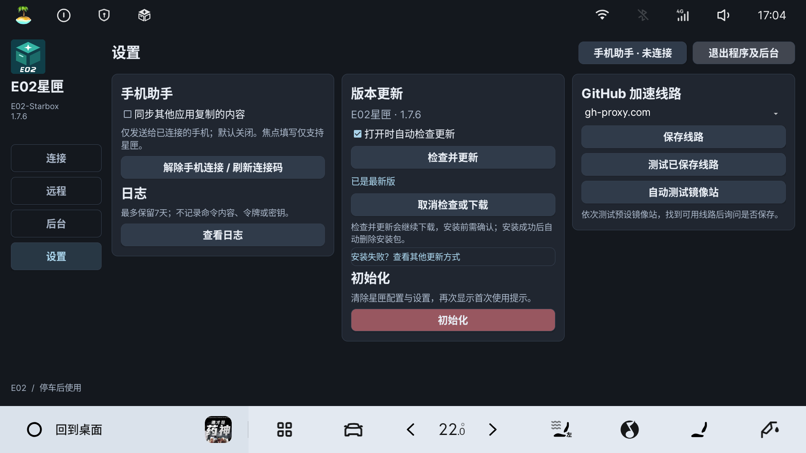
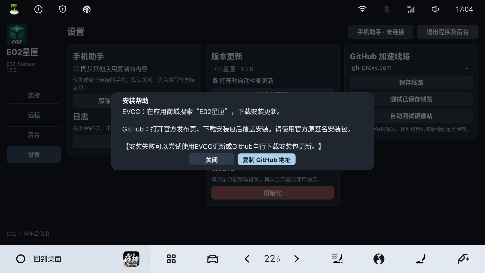

# 版本更新

如果安装失败或旧版点击安装会闪退，可以在 EVCC 应用商城搜索“E02星匣”安装更新，或从 [GitHub 官方最新发布页](https://github.com/BerryFuwawa/E02-StarBox/releases/latest)下载安装包后覆盖安装。请使用官方原签名安装包，保留已有设置。

## 检查与下载

1. 先在「连接」页完成 [Root 授权](Root授权与手机助手.md)。
2. 在「设置」点击「检查并更新」。发现新版后会继续下载，页面显示下载进度；已是最新版时会直接提示。
3. 打开星匣时的自动检查只作提醒：点击右下角「发现更新 - 版本号 - 点击查看」，阅读更新内容后点击「下载」。已是最新版时不会出现提醒。
4. 下载完成后点击「安装」，确认使用当前 Root 授权覆盖安装。

安装包保存在车机下载文件夹。安装时星匣可能关闭，完成后重新打开即可；已有设置保留，安装成功后自动删除对应安装包。

下载完成后仍需确认安装，不会未经确认安装。取消安装会保留完整安装包，稍后可在设置点击「安装已下载的更新」，也可点击右下角继续。安装失败同样保留文件；取消下载或下载校验失败会清理此次临时文件。不会清理下载文件夹中的其他文件。

## 检查失败与镜像站

1. 点击右下角「检测更新失败，点击查看」，进入设置。
2. 点击「建议使用镜像站，点击进行网络测试」或「自动测试镜像站」。
3. 星匣依次测试预设镜像站，找到可用线路后停止，并询问是否用于今后的更新检查和下载。
4. 点击「使用」保存线路；点击「取消」保留原线路。测试过程中也可取消。

也可手动选择线路或填写自定义 HTTPS 域名，再点击「保存线路」。镜像站可用性可能变化；下载后仍会校验文件完整性，确认安装包属于星匣且签名一致。

## 常见情况

- **Root不可用**：在连接页启用独立授权或重新检测；本机须已有可用的 Root ADB。
- **下载失败**：检查网络、切换可用镜像站后重试。
- **安装未完成**：保留的安装包可重试；重新打开后以软件显示的实际版本为准。
- **安装失败**：点击右下角提示或设置中的“查看安装失败原因”，查看具体原因。可重试安装，仍需确认；也可复制 GitHub 地址，或前往 EVCC 应用商城更新。设置中的“安装失败？查看其他更新方式”随时可查看安装帮助。
- **安装完成但文件未删除**：按提示在下载文件夹手动删除对应星匣安装包。
- **远程连接中断**：覆盖安装可能停止星匣服务，重新打开后按需启动远程连接。

## 更新说明中的安装帮助

每个版本的在线更新说明最后一行固定保留安装帮助，以【】标出。该行内容可随后在线调整；旧版成功获取更新说明后，也能在原有更新界面看到，不必先安装新版。它不是消息推送，无法联网获取说明时不能同步；也不能改变已安装旧版的弹窗按钮或修复旧版自身的安装异常。

【安装失败可以尝试使用EVCC更新或Github自行下载安装包更新。】

## 界面示例

以下为 v1.7.6 在车机上的原始截图。当前可下载版本以[官方发布页](https://github.com/BerryFuwawa/E02-StarBox/releases/latest)为准。

设置中的安装帮助入口：

安装帮助支持复制官方 GitHub 地址，复制后弹窗保持打开；关闭弹窗不执行安装。

